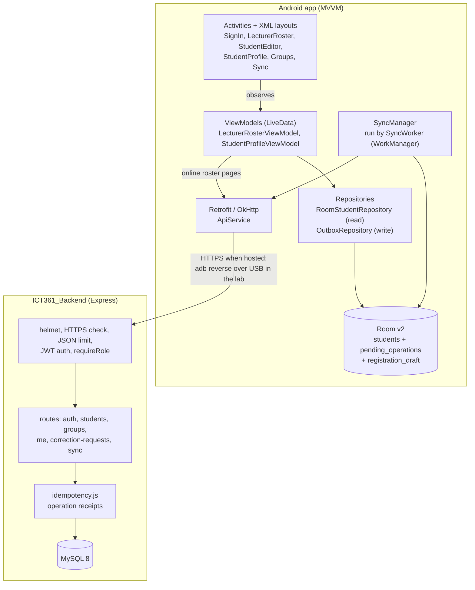
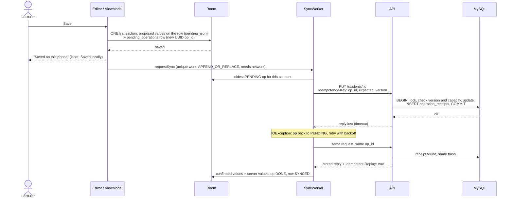

# Architecture

## Layers

- **Activities** only draw state and pass clicks on. They never call the network or Room directly.
- **ViewModels** survive rotation, so a typed search, the loaded pages and an open dialog's input are not lost.
- **OutboxRepository** is the only way the app changes data. It writes to Room, never straight to the server.
- **SyncManager** is the only code that sends changes. WorkManager runs it, so it continues after the app is closed and waits for a network connection.

## Offline-first writes (Activity E)

### Rules the outbox follows

| Situation | What the phone does |
|---|---|
| Saved, not yet tried | Label **Saved locally**. Proposed values are in `pending_json`; the confirmed values are untouched. |
| Being sent | **Syncing**. Discard is refused until the reply arrives. |
| No network, timeout, 5xx | Op returns to PENDING with the **same** op_id. WorkManager retries with exponential backoff (30 s start); a 15-minute periodic job is the safety net. |
| 401 | Queue pauses and the screen says to sign in again. Nothing is lost. |
| 409 / 410 / 4xx refusal | **Action required** with a plain message (group full, changed by someone else, deleted). Later ops for that student wait; other students keep syncing. |
| Discard my change | Drops the open ops. The row goes back to the confirmed server values (a never-sent new student is removed). |
| Re-apply after a conflict | A new edit based on the server's current version, with a new op_id. The refused op is closed. |
| Several edits offline | Sent in order. The second one carries `base_version` 0 and gets the version the first one produced, at send time. |
| Created and edited before sending | The edit is folded into the queued CREATE. |
| Created and deleted before sending | Both are dropped; nothing is sent. |
| Sign out or session timeout | Cached students are cleared, but the queue is kept per account (`account_id`), so one person's ops are never sent with another's token. |

After pushing, `SyncManager` pulls `GET /sync/changes?since=` to bring in other people's changes,
then refreshes group occupancy.

## Group capacity (Challenge 1)

Two phones asking for the last place must never both get it. Every route that puts a student
in a group (create, PUT, assign, the student's group request) does this in **one transaction**:

1. `SELECT ... FROM lab_groups WHERE group_code = ? FOR UPDATE`: the second request waits here.
2. `SELECT COUNT(*) ... FROM students WHERE group_id = ? AND is_deleted = FALSE LOCK IN SHARE MODE`: a *locking* read, so it sees the first request's committed student. A plain `SELECT` under REPEATABLE READ would read an old snapshot and allow 16/15. That was a real bug we found and fixed.
3. If `count >= capacity`, reply `409 GROUP_FULL` and leave the student where they were.
4. Otherwise update the student, bump `record_version`, write `sync_changes` and the receipt, then commit.

The group row is always locked before the student row, on every route, so two transfers in
opposite directions cannot deadlock.

The phone's "group full" check is only a hint for the dialog; the server decides. A group request
saved offline shows **Pending** and reserves nothing.

## Roster (Activity D)

- **Online:** search, programme and group filters go to `GET /students`, 20 per page. More pages load on scroll. Typing is debounced (300 ms), the previous call is cancelled, and a reply for an older query is ignored (sequence number).
- **Offline or session expired:** the same filters run on the Room copy, and a banner says it is this phone's copy and may be incomplete.
- Either way, students with unsynced changes show their label, and unconfirmed new students appear first.

## Roles

| | Lecturer | Student |
|---|---|---|
| Roster, create, edit, delete, claim codes | ✔ | ✘ 403 |
| Assign a group directly | ✔ | ✘ |
| Own profile: name, programme | — | ✔ `/me/student` |
| Ask for a group (a lecturer approves; capacity checked at approval) | ✔ approves `/group-requests` | ✔ asks `/me/group-request` |
| Send announcements (all students or one group) | ✔ `/announcements` | ✘ reads them in Notifications |
| Change own student number | ✔ approves a request | asks only (`/me/correction-requests`) |

Checked on the server in `requireRole` and in `/me` (the student comes from the token).
`npm run test:roles` proves it with 17 checks.

## Security

- Passwords and claim codes are stored as bcrypt hashes. Claim codes are one-time and expire after 15 minutes.
- JWT tokens last 2 hours. The app clears the token and cached students on sign-out and after inactivity (`SessionTimeout`).
- `helmet` headers, a 20 KB JSON body limit, and parameterised SQL everywhere.
- HTTPS: `REQUIRE_HTTPS=true` refuses plain HTTP with 426, and `TRUST_PROXY=true` makes this work behind a host's HTTPS proxy. In the lab, traffic goes over the USB cable (`adb reverse`).
- Secrets live only in `.env`, which is gitignored. `.env.example` lists the keys with no values.
- The Sharesheet "Share group summary" sends group labels and counts only, never names or numbers.
