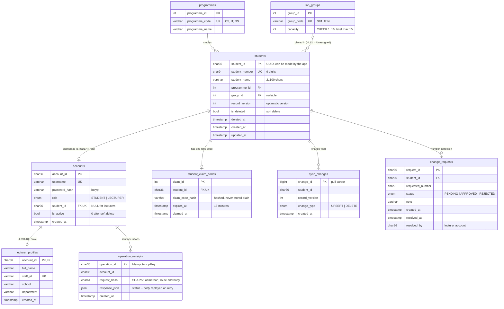
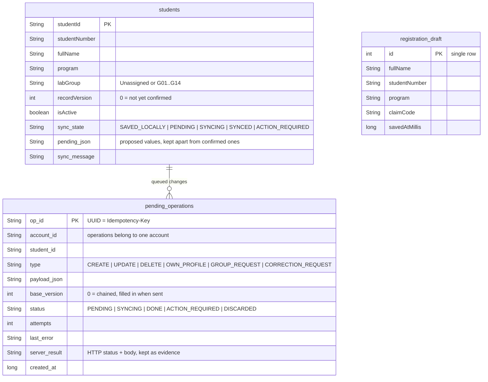

# ER Diagram

## Server (MySQL `ict361_registration`)

Built from `ICT361_Backend/db/schema.sql`, which was exported from the running database with
`SHOW CREATE TABLE`, plus `change_requests` from migration 002.

### Rules the database enforces

- `students.student_number` is unique and must be exactly 9 digits, so two students can never share a number. Soft-deleted numbers stay reserved.
- `accounts.student_id` is unique, so each student record can be claimed by one account at most.
- `operation_receipts.operation_id` is the primary key. The receipt is written in the same transaction as the change, so a replayed operation finds it and returns the stored reply.
- Group capacity is checked in the transaction that changes the group. The `lab_groups` row is locked `FOR UPDATE` first, then the active students are counted with `LOCK IN SHARE MODE`. See [ARCHITECTURE.md](ARCHITECTURE.md#group-capacity-challenge-1).
- The `lab_groups` CHECK allows up to 16 because four groups (G01, G04, G09, G10) were already at 16 when we exported. The brief's maximum is 15; see the open item in [TEST_EVIDENCE.md](TEST_EVIDENCE.md).

## Phone (Room `AppDatabase`, version 2)

`MIGRATION_1_2` adds the three sync columns to `students` (existing rows become `SYNCED`) and
creates `pending_operations` with the index `(account_id, status, created_at)`. `MigrationTest`
checks it on a real phone.
